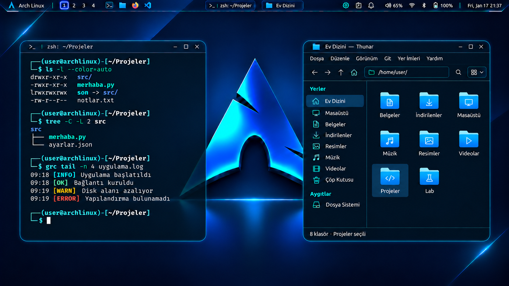

# Arch Desktop Theme

Koyu lacivert Arch masaüstü; üst görev çubuğu, Zsh terminali, Thunar, açılış ve kilit ekranı için onaylı tasarım ve kurulum tanımları.

**İlk GitHub sürümü: v1.0.** Güncel kaynak her zaman [`paket/`](paket/) dizinidir. Kurulumu hedef Arch Linux bilgisayarındaki Codex, gerçek masaüstü ve donanımı inceleyerek uygular. Bu repo, kurulumun tamamlandığını gösteren bir sistem imajı veya tek komutluk otomatik yükleyici değildir.



## Arch üzerinde kurulum

[Codex'e verilecek hazır isteği](CODEXE-VERILECEK-ISTEK.txt) kopyalayın. İstek repo bağlantısını da içerir; Codex'ten repoyu bilgisayara çekmesini ve kurulumu uygulamasını ister.

Kendiniz indirmek isterseniz:

```sh
git clone https://github.com/memin8742/arch-desktop-theme.git
cd arch-desktop-theme
python3 tools/package.py check
```

Ardından bu klasörde Codex'e [`KURULUM.md`](KURULUM.md) ve `paket/` içindeki talimatları uygulamasını söyleyin. Kurulumdan önce değişecek ayarlar yedeklenir; uygulama ve donanım desteği gerçek sistemde kontrol edilir.

## Tasarım ve özellikler

- Terminal ve Thunar: mevcut koyu lacivert zemin, **%80 zemin opaklığı**, tam opak yazı/simgeler ve her kenar/köşede hafif, eşit mavi çerçeve ışığı.
- Terminal: Fira Code 10 pt, Zsh, iki satırlı dinamik dizin istemi, Kali temelli yazı/çıktı renkleri, geçmiş önerileri ve arama. İnce, yarı saydam, **üçgensiz** bölücüler ve bağımsız bölümler.
- Üst panel: dört çalışma alanı, uygulamalar, pano geçmişi, bildirimler ve açılır sistem/batarya kutuları. Donanım verileri gerçek ölçülür.
- Onaylı kısayollar, seçim/kopyalama/yapıştırma davranışları, ekran görüntüsü/kaydı, tema dışa aktarma ve uzun işlem bildirimi.
- Donanım destekliyorsa Ev şarj sınırları %55/%80, Seyahat geçici %100. Açılış, giriş ve gerçek oturum kilidi korunur.

Kesin fontlar, renkler, bütün **27 kısayol**, işlevler ve kabul kontrolleri [`04-ayarlar-ve-ozellikler.json`](paket/04-ayarlar-ve-ozellikler.json) içindedir. Görseller tasarım önizlemesidir; içlerindeki örnek komutlar kurulum talimatı sayılmaz.

## Güncelleme ve sürümler

Onaylı değişiklikler aynı repoya commit olarak gönderilir. Güncel bilgisayarda:

```sh
git pull --ff-only
python3 tools/package.py check
```

Sonra Codex'ten yeni tanımları mevcut kuruluma, kişisel ayarları ve yedekleri koruyarak uygulamasını isteyin. Dosyaları çekmek tek başına masaüstü ayarlarını değiştirmez.

[Yayımlanmış sürümler ve ZIP paketleri](https://github.com/memin8742/arch-desktop-theme/releases) · [Değişiklikler](CHANGELOG.md) · [Kurulum ayrıntıları](KURULUM.md)

Kaynak doğrulama ve ZIP üretimi yalnız Python standart kütüphanesini kullanır:

```sh
python3 tools/package.py check
python3 tools/package.py build
```

Yeni içerik/sürüm hazırlanırken önce `VERSION` ve tanımlar güncellenir; ardından `python3 tools/package.py sync` özetleri yeniler. ZIP ve SHA256 dosyası `dist/` altında üretilir, Git geçmişine eklenmez. Videolar ve eski alternatif tasarımlar bu repoya alınmaz.
